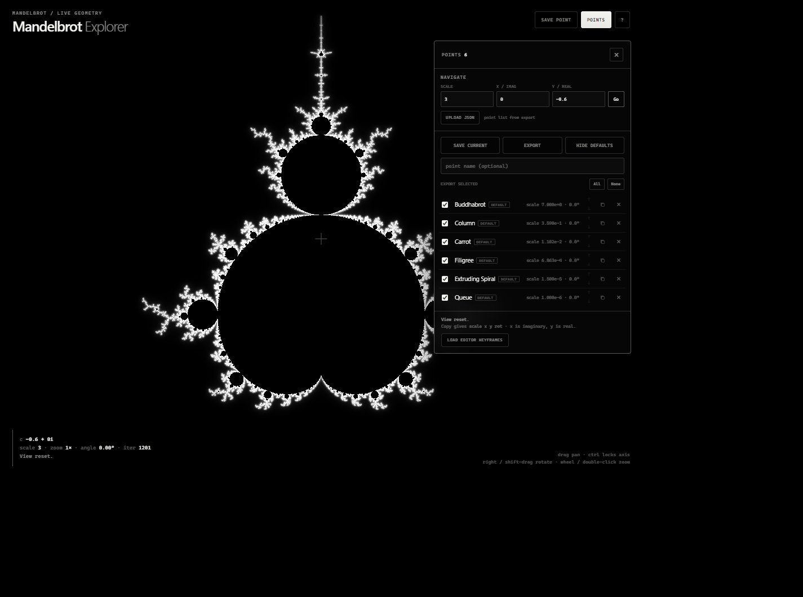

# Mandelbrot Explorer 

Browser app for exploring the Mandelbrot set and saving points.

- **`explore.html`** — free live exploration, saved points, deep rendering.

## Screenshots

*Live explorer with saved camera points and the navigate panel.*

*Filigree, one of the deep CPU-rendered views.*

## Explorer

`explore.html` is a live Mandelbrot explorer.

- Pan, zoom, rotate, and center-targeted double-click zoom.
- GPU renderer above `5e-5`; float64 CPU workers below it.
- Saved points with names, rotation, include/exclude checkboxes, and export order.
- Hide the six default editor keyframes, reorder custom points, or select all/none.
- Navigate by typing `scale`, `x` (imaginary), `y` (real), or upload a JSON point list.
- Copy/save values as `scale x y rot`.
- Points and view are stored in `localStorage`.
- Standalone: no assets or manifest needed, so it works as a single file on
  GitHub Pages or any static host.

### Explorer controls

| Control | Action |
|---|---|
| drag | pan |
| ctrl-drag | lock pan to one screen axis |
| right / shift-drag | rotate around center |
| wheel | zoom at cursor |
| double-click | zoom in at center; shift-double-click zooms out |
| arrow keys | left/right: imaginary axis; up/down: real axis |
| `+` / `−` | zoom at center |
| `Q` / `E` | rotate |
| `T` | invert |
| `S` | save current point and copy values |
| `P` | points panel |
| `I` / `?` | info panel |
| `H` | hide HUD, title, and hints |
| `R` | reset view |
| `F` | fullscreen |
